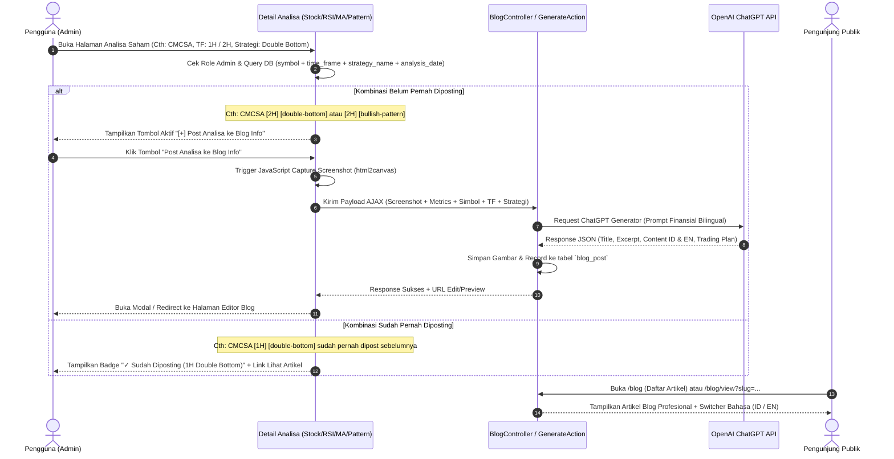

# Rencana Arsitektur & Implementasi: Fitur Blog Info Saham AI Bilingual

Dokumen rencana kerja ini merinci alur kerja, arsitektur data, integrasi AI (ChatGPT/OpenAI), mekanisme screenshot otomatis, serta sistem dwibahasa (Indonesia & Inggris) untuk fitur **Blog Info Saham**.

---

## 1. Ikhtisar Kebutuhan Fitur (Overview)

1. **Akses Publik**: Siapapun (pengunjung umum tanpa login) dapat membaca artikel blog seputar analisa saham.
2. **Hak Akses Khusus Admin**: Hanya user dengan role `admin` (`Yii::$app->user->identity->role === 'admin'`) yang memiliki wewenang untuk membuat, menerbitkan, mengedit, atau menghapus postingan.
3. **Tombol Cepat di Detail Analisa Saham** (`views/stock/view.php` serta modul analisa lainnya seperti RSI Double Bottom, Moving Average, Candlestick, dll.):
   - Muncul khusus ketika user yang login adalah **Admin**.
   - **Pengecekan Granular / Mendetail (Simbol + Time Frame + Strategi + Tanggal/Sesi)**:
     - Sistem membedakan secara spesifik kombinasi: **`symbol` + `time_frame` + `strategy_name` + `analysis_date`**.
     - **Contoh Kasus Riil**:
       - Saham `CMCSA` pada time frame `1H` dengan strategi `double-bottom` sudah diposting -> Sistem menandai **sudah diposting** (menampilkan badge/link ke artikel tersebut).
       - Saham `CMCSA` pada time frame `2H` dengan strategi `double-bottom` -> Sistem mendeteksi kombinasi baru -> **BISA diposting kembali**.
       - Saham `CMCSA` pada time frame `2H` dengan strategi `bullish-pattern` (atau `moving-average`) -> Sistem mendeteksi strategi berbeda -> **BISA diposting kembali**.
     - Hal ini memberi fleksibilitas tinggi bagi admin untuk mempublikasikan berbagai sudut pandang setup teknikal untuk emiten yang sama tanpa saling menimpa atau terhalang duplikasi palsu.
4. **Mekanisme Otomatis saat Tombol Ditekan**:
   - **Langkah 1 (Screenshot Otomatis)**: Mengambil gambar visual dari halaman analisa saham (chart candlestick, indikator teknikal, ringkasan volume) menggunakan library JavaScript modern di sisi klien (`html2canvas` / `dom-to-image`) atau background headless capture lalu disimpan ke direktori web upload server (`@webroot/uploads/blog/`).
   - **Langkah 2 (Pengumpulan Data Analisa)**: Mengumpulkan metrik teknikal penting saham saat itu: simbol, harga terkini, perubahan %, sinyal volume, Moving Average, RSI, support/resistance, sentimen, dll.
   - **Langkah 3 (Integrasi AI ChatGPT)**: Mengirimkan data metrik ke OpenAI API (Chat Completion model misal `gpt-4o-mini` / `gpt-4o` / `gpt-3.5-turbo`) dengan instruksi khusus (*system prompt*) analis pasar modal berpengalaman untuk menghasilkan:
     - Judul menarik & SEO-friendly (ID & EN).
     - Ringkasan eksekutif / key takeaways.
     - Analisis mendalam teknikal & prospek pasar (ID & EN).
     - Trading plan: level support, resistance, target harga (take profit), dan stop loss.
   - **Langkah 4 (Draft & Penyimpanan)**: Postingan otomatis tersimpan dan admin diarahkan ke formulir preview/review artikel blog untuk pengecekan akhir sebelum tayang live.
5. **Dukungan 2 Bahasa (Bilingual: ID & EN)**:
   - Bahasa utama: **Bahasa Indonesia** (`id-ID`).
   - Bahasa kedua: **Bahasa Inggris** (`en-US`).
   - Pengunjung umum dapat beralih bahasa dengan mudah melalui tombol switcher bahasa (ID | EN) di navigasi blog tanpa memuat ulang seluruh halaman dari awal.

---

## 2. Desain Database & Skema Tabel

Dibuat migrasi baru Yii2: `m261023_XXXXXX_create_blog_tables.php`

### Tabel: `{{%blog_post}}`
Menampung entitas artikel blog utama dan relasinya ke analisa saham:
```sql
CREATE TABLE {{%blog_post}} (
    id INT AUTO_INCREMENT PRIMARY KEY,
    stock_id INT NULL,
    symbol VARCHAR(16) NOT NULL,
    time_frame VARCHAR(16) NOT NULL DEFAULT '1D', -- Cth: '1H', '2H', '4H', '1D', '1W'
    strategy_name VARCHAR(64) NOT NULL DEFAULT 'general', -- Cth: 'double-bottom', 'bullish-pattern', 'moving-average', 'volume-breakout'
    analysis_date DATE NOT NULL,
    slug_id VARCHAR(255) NOT NULL UNIQUE,
    slug_en VARCHAR(255) NOT NULL UNIQUE,
    title_id VARCHAR(255) NOT NULL,
    title_en VARCHAR(255) NOT NULL,
    excerpt_id TEXT NULL,
    excerpt_en TEXT NULL,
    content_id LONGTEXT NOT NULL,
    content_en LONGTEXT NOT NULL,
    featured_image VARCHAR(255) NULL,
    trading_plan JSON NULL,               -- Support, resistance, TP, SL, signal, time frame
    tags VARCHAR(255) NULL,               -- e.g. "CMCSA, Double Bottom, 2H, Bullish"
    meta_title_id VARCHAR(255) NULL,      -- SEO Title Tag (50-60 karakter)
    meta_title_en VARCHAR(255) NULL,
    meta_desc_id VARCHAR(320) NULL,       -- Meta Description (150-160 karakter)
    meta_desc_en VARCHAR(320) NULL,
    author_id INT NOT NULL,
    status VARCHAR(20) DEFAULT 'published', -- 'draft', 'published', 'archived'
    views_count INT DEFAULT 0,
    created_at INT NOT NULL,
    updated_at INT NOT NULL,
    INDEX idx_blog_symbol_tf_strat_date (symbol, time_frame, strategy_name, analysis_date),
    INDEX idx_blog_status_created (status, created_at),
    FOREIGN KEY (author_id) REFERENCES {{%user}}(id) ON DELETE CASCADE,
    FOREIGN KEY (stock_id) REFERENCES {{%stock}}(id) ON DELETE SET NULL
) ENGINE=InnoDB DEFAULT CHARSET=utf8mb4 COLLATE=utf8mb4_unicode_ci;
```

> **Logika Deteksi Duplikasi Mendetail (Granular Post Check)**:
> Query pengecekan sebelum tombol tampil atau posting dieksekusi:
> ```php
> $existingPost = BlogPost::find()
>     ->where([
>         'symbol' => $symbol,
>         'time_frame' => $timeFrame,         // Contoh: '1H', '2H', '1D'
>         'strategy_name' => $strategyName,   // Contoh: 'double-bottom', 'bullish-pattern'
>         'analysis_date' => $analysisDate,   // Tanggal candle/analisa sesi saat ini
>     ])
>     ->one();
> ```
> Dengan aturan ini:
> 1. `CMCSA` + `1H` + `double-bottom` -> **Sudah Pernah Dipost** (Tidak perlu post lagi).
> 2. `CMCSA` + `2H` + `double-bottom` -> **Kombinasi Baru** -> **Bisa Diposting**.
> 3. `CMCSA` + `2H` + `bullish-pattern` -> **Strategi Berbeda** -> **Bisa Diposting**.

---

## 3. Komponen Layanan & Integrasi AI (OpenAI ChatGPT)

### 3.1. `app\services\OpenAiBlogService.php`
Service khusus untuk menangani interaksi dengan OpenAI API:
- **Konfigurasi API**: Menyimpan `OPENAI_API_KEY` dan model default di `config/params.php` (mendukung fallback environment variable).
- **Format Prompt Khusus Finansial Bilingual**: Prompt meminta output dalam format JSON terstruktur yang memuat versi Indonesia dan Inggris sekaligus:
  ```json
  {
    "title_id": "...",
    "title_en": "...",
    "excerpt_id": "...",
    "excerpt_en": "...",
    "content_id": "...",
    "content_en": "...",
    "trading_plan": {
      "bias": "BULLISH / BEARISH / NEUTRAL",
      "support": 120.50,
      "resistance": 135.00,
      "target_price": 140.00,
      "stop_loss": 115.00,
      "risk_reward_ratio": "1:2.5"
    },
    "tags": ["NVDA", "Technology", "Breakout"]
  }
  ```

---

## 4. Mekanisme Screenshot Halaman Analisa

Ada dua pendekatan handal yang disiapkan:

1. **Client-Side High Fidelity Capture (Disarankan & Cepat)**:
   - Menggunakan library `html2canvas` yang disuntikkan secara dinamis saat tombol post blog ditekan oleh admin.
   - Mengambil target elemen utama (kartu chart candlestick, panel sinyal indikator, level support/resistance).
   - Mengonversi elemen menjadi format gambar PNG/WebP base64, lalu dikirim via AJAX multipart POST ke endpoint backend `/blog/admin/generate-from-stock`.
   - Backend memvalidasi, mengompresi gambar, dan menyimpannya di folder `web/uploads/blog/{symbol}_{date}.png`.

2. **Keunggulan Pendekatan Ini**:
   - Gambar yang tersimpan identik 100% dengan apa yang dilihat admin di layarnya (termasuk rendering candlestick Lightweight Charts / Chart.js).
   - Tidak memerlukan dependensi server yang berat seperti Chromium / Puppeteer.

---

## 5. Alur Interaksi Pengguna (User Flow)



---

## 6. Struktur Menu & Antarmuka (UI/UX)

1. **Menu Navigasi Utama** (`views/layouts/main.php`):
   - Tambahkan menu link publik: **"📰 Blog Info Saham"** yang bisa diakses siapa saja.
2. **Halaman Publik Blog**:
   - `/blog/index`: Grid kartu artikel modern bergaya portal finansial (dilengkapi badge sentimen saham, harga saat analisa, pencarian, dan filter tag/emiten).
   - `/blog/view?slug=...`: Tampilan detail artikel responsif dengan format tipografi elegan:
     - Header artikel, tanggal analisa, dan tombol toggle **ID | EN**.
     - Gambar visual screenshot chart hasil tangkapan analisa.
     - Ringkasan eksekutif (Executive Summary).
     - Breakdown Analisis Mendalam AI (Pola Candlestick, Volume Breakout, Indikator).
     - Kotak Trading Plan (Tabel Support, Resistance, Risk/Reward).
     - Tombol Call-to-Action ke halaman live tool analisa saham tersebut.
3. **Manajemen Admin Blog**:
   - `/blog/admin`: Kelola artikel, edit konten dwibahasa, ubah status publish/draft, atau hapus artikel.

---

## 7. Standar Optimasi Google Search SEO & Rich Snippets

Untuk menjamin setiap artikel blog yang dipublish terindeks optimal di halaman pertama Google Search dan memunculkan Rich Results finansial yang menarik:

1. **Struktur Tag Metadata & Open Graph Dinamis**:
   - `<title>`: Judul presisi 50-60 karakter, memuat simbol saham, strategi, time frame, dan brand (Cth: `CMCSA Double Bottom (2H) - Analisis Saham & Trading Plan | StockAnalyzer`).
   - `<meta name="description">`: Ringkasan padat 140-160 karakter memuat level krusial support/resistance dan bias pasar.
   - `<link rel="canonical">`: Menunjuk ke URL kanonikal artikel untuk mencegah duplikasi konten antar-bahasa.
   - `<link rel="alternate" hreflang="id" ...>` dan `<link rel="alternate" hreflang="en" ...>` serta `hreflang="x-default"` untuk multi-bahasa resmi Google Search.
   - Open Graph (`og:title`, `og:description`, `og:image`, `og:type="article"`) dan Twitter Card (`summary_large_image`) agar cuplikan artikel tampil sempurna saat dibagikan di WhatsApp, Telegram, X/Twitter, dan LinkedIn.

2. **Schema.org Structured Data (JSON-LD)**:
   Setiap artikel dilengkapi skrip Schema JSON-LD berstandar Google:
   - `Article` / `NewsArticle`: Memuat `headline`, `image`, `datePublished`, `dateModified`, `author` (Organization/Analyst), dan `publisher`.
   - `FinancialProduct` / `Stock`: Mengaitkan ticker saham (`tickerSymbol: CMCSA`) dan bursa (`exchange: NASDAQ`).
   - `BreadcrumbList`: Menghasilkan jalur navigasi hierarkis pada cuplikan hasil pencarian Google (*Home > Blog > CMCSA*).

3. **Hierarki Semantic HTML5**:
   - Tepat **satu tag `<h1>`** per halaman artikel.
   - Tag sub-bagian terstruktur rapi: `<h2>` untuk Ringkasan & Setup Pola, `<h3>` untuk Level Kunci (Support/Resistance/Risk-Reward), dan `<p>` dengan keterbacaan tinggi.
   - Tag gambar `` wajib memiliki atribut `alt` deskriptif (Cth: `alt="Chart Analisis Teknikal CMCSA Timeframe 2H Strategi Double Bottom"`).

4. **Sitemap XML & Feed**:
   - Endpoint `/blog/sitemap.xml` yang secara otomatis mendaftarkan URL artikel blog versi Indonesia dan Inggris agar langsung dirayapi (*crawled*) oleh Googlebot.

---

## 8. Standar Kecepatan & Kinerja Google PageSpeed Insights (Core Web Vitals)

Target skor **90-100 (Hijau)** pada uji Google PageSpeed Insights (Mobile & Desktop) dengan mematuhi Core Web Vitals (LCP, INP, CLS):

1. **Largest Contentful Paint (LCP < 2.5s)**:
   - **Modern Image WebP Compression**: Screenshot chart otomatis dikompresi ke format `.webp` yang ringan dengan kompresi kualitas optimal (~75-80%), memangkas ukuran berkas hingga 60-80% dibanding PNG murni.
   - **Ukuran Dimensi Eksplisit**: Setiap tag gambar `` wajib memiliki atribut `width` dan `height` serta `srcset` responsif.
   - **Hero Image Preload**: Gambar screenshot utama diberi atribut `loading="eager"` dan `fetchpriority="high"`, sementara gambar di bawah layar menggunakan `loading="lazy"`.

2. **Cumulative Layout Shift (CLS < 0.1 - Nol Pergeseran Layar)**:
   - Area kontainer gambar chart, banner hero, dan widget trading plan memiliki rasio aspek CSS terdefinisi (`aspect-ratio: 16/9` atau `min-height`) sehingga tidak menyebabkan pergeseran layout mendadak saat gambar selesai diunduh.
   - Font modern sistem atau Google Font dengan CSS `font-display: swap`.

3. **Interaction to Next Paint (INP < 200ms) & Kecepatan Eksekusi**:
   - **Bilingual Client Switcher Ringan**: Perpindahan bahasa ID $\leftrightarrow$ EN menggunakan atribut data HTML (`data-lang-content`) dan manipulasi DOM instan tanpa request HTTP bolak-balik, memberikan respon klik < 50ms.
   - **CSS/JS Minimalis**: Memanfaatkan vanilla CSS dan Bootstrap 5 yang sudah ter-bundle, tanpa pustaka eksternal pihak ketiga yang membebani browser pengunjung.
   - **Browser Caching**: Konfigurasi header cache pada `.htaccess` untuk aset gambar, WebP, CSS, dan JS statis (`Cache-Control: public, max-age=31536000`).

## 9. Modul Pengaturan Webmaster, SEO & Tracking Analytics (Admin Settings)

Agar admin tidak perlu menyentuh kode program (*zero-code configuration*) saat mendaftarkan situs ke Google atau alat analitik lainnya, disediakan halaman **Pengaturan Webmaster & Tracking (`/blog/admin/settings`)**:

### 9.1. Skema Tabel Penyimpanan Pengaturan: `{{%site_setting}}`
Dibuat tabel dinamis berbasis *key-value* berindeks cepat:
```sql
CREATE TABLE {{%site_setting}} (
    id INT AUTO_INCREMENT PRIMARY KEY,
    category VARCHAR(64) NOT NULL DEFAULT 'seo', -- 'seo', 'analytics', 'general'
    setting_key VARCHAR(128) NOT NULL UNIQUE,
    setting_value LONGTEXT NULL,
    description VARCHAR(255) NULL,
    updated_at INT NOT NULL,
    INDEX idx_setting_category (category)
) ENGINE=InnoDB DEFAULT CHARSET=utf8mb4 COLLATE=utf8mb4_unicode_ci;
```

### 9.2. Bidang-Bidang Pengaturan yang Disediakan:

1. **Google Search Console & Webmaster Verification**:
   - **Google Site Verification Token**: Kode meta verifikasi kepemilikan Google (`google-site-verification` tag).
   - **Bing Webmaster Tools Verification**: Kode meta verifikasi Bing (`msvalidate.01`).
   - **Yandex / Baidu / Pinterest Verification**: Opsi meta verifikasi mesin pencari lainnya.

2. **Google Analytics 4 (GA4) & Google Tag (gtag.js)**:
   - **Measurement ID**: Input ID pengukuran GA4 (Cth: `G-XXXXXXXXXX`).
   - Sistem otomatis menanamkan script resmi `googletagmanager.com/gtag/js` secara asynchronous (`async`) berstandar Google PageSpeed tanpa memblokir rendering halaman.

3. **Google Tag Manager (GTM)**:
   - **GTM Container ID**: Input ID kontainer GTM (Cth: `GTM-XXXXXXX`).
   - Sistem otomatis menyisipkan:
     - Snippet `<script>` di dalam tag `<head>` secara optimal.
     - Snippet `<noscript><iframe ...>` tepat setelah pembuka tag `<body>`.

4. **Custom Tracking & Analytics Scripts (Fleksibilitas Tambahan)**:
   - **Custom Head Scripts**: Kolom textarea untuk menambahkan script tambahan sebelum penutup `</head>` (misal: Meta Pixel / Facebook Pixel, Twitter/X Tag, Clarity Heatmap).
   - **Custom Body/Footer Scripts**: Kolom textarea untuk script pelacak sebelum penutup `</body>`.

### 9.3. Integrasi Otomatis & Kinerja PageSpeed:
- Skrip tracking hanya dimuat pada halaman publik (`/blog/*` atau seluruh halaman aplikasi jika diaktifkan), dan secara cerdas **dikecualikan/dinonaktifkan** saat admin sedang mengedit di backend agar tidak mengotori data statistik kunjungan (*filter internal traffic*).
- Seluruh script pelacak diinjeksi dengan atribut `async` atau `defer` agar **tidak menurunkan skor Google PageSpeed Insights**.

---

## 10. Rencana Tahapan Eksekusi (Implementation Steps)

| Tahap | Aktivitas Utama | Output |
| :--- | :--- | :--- |
| **Tahap 1** | Migrasi Database | Tabel `{{%blog_post}}` dan tabel pengaturan `{{%site_setting}}` |
| **Tahap 2** | Model & Validasi | Model `app\models\BlogPost` dan `app\models\SiteSetting` dengan cache helper |
| **Tahap 3** | Service OpenAI | `OpenAiBlogService` untuk prompt analisis saham dwibahasa + SEO meta generator |
| **Tahap 4** | Controller & Logic | `BlogController` (akses publik, sitemap XML, dan admin action ber-auth RBAC) |
| **Tahap 5** | Integrasi di Detail Saham | Tombol conditional admin di `views/stock/view.php` + html2canvas screenshot + AJAX |
| **Tahap 6** | Halaman Blog Publik (SEO & PageSpeed) | View index & view detail dengan Semantic HTML5, JSON-LD Schema, WebP, dan switcher ID/EN |
| **Tahap 7** | Halaman Setting Admin | Form UI `/blog/admin/settings` untuk input kode Google Search Console, GA4, GTM, dll. |
| **Tahap 8** | Pengujian & Verifikasi | Verifikasi tracking script, duplikasi granular, uji Lighthouse PageSpeed, dan validator schema.org |

---

*Catatan: Dokumen rencana ini tersimpan untuk ditinjau. Silakan berikan masukan atau konfirmasi untuk memulai langkah implementasi.*

