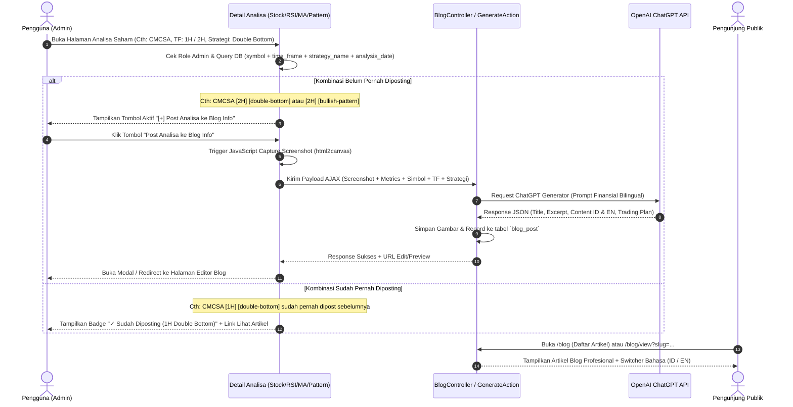

# Rencana Arsitektur & Implementasi: Fitur Blog Info Saham AI Bilingual

Dokumen rencana kerja ini merinci alur kerja, arsitektur data, integrasi AI (ChatGPT/OpenAI), mekanisme screenshot otomatis, serta sistem dwibahasa (Indonesia & Inggris) untuk fitur **Blog Info Saham**.

---

## 1. Ikhtisar Kebutuhan Fitur (Overview)

1. **Akses Publik**: Siapapun (pengunjung umum tanpa login) dapat membaca artikel blog seputar analisa saham.
2. **Hak Akses Khusus Admin**: Hanya user dengan role `admin` (`Yii::$app->user->identity->role === 'admin'`) yang memiliki wewenang untuk membuat, menerbitkan, mengedit, atau menghapus postingan.
3. **Tombol Cepat di Detail Analisa Saham** (`views/stock/view.php` serta modul analisa lainnya seperti RSI Double Bottom, Moving Average, Candlestick, dll.):
   - Muncul khusus ketika user yang login adalah **Admin**.
   - **Pengecekan Granular / Mendetail (Simbol + Time Frame + Strategi + Tanggal/Sesi)**:
     - Sistem membedakan secara spesifik kombinasi: **`symbol` + `time_frame` + `strategy_name` + `analysis_date`**.
     - **Contoh Kasus Riil**:
       - Saham `CMCSA` pada time frame `1H` dengan strategi `double-bottom` sudah diposting -> Sistem menandai **sudah diposting** (menampilkan badge/link ke artikel tersebut).
       - Saham `CMCSA` pada time frame `2H` dengan strategi `double-bottom` -> Sistem mendeteksi kombinasi baru -> **BISA diposting kembali**.
       - Saham `CMCSA` pada time frame `2H` dengan strategi `bullish-pattern` (atau `moving-average`) -> Sistem mendeteksi strategi berbeda -> **BISA diposting kembali**.
     - Hal ini memberi fleksibilitas tinggi bagi admin untuk mempublikasikan berbagai sudut pandang setup teknikal untuk emiten yang sama tanpa saling menimpa atau terhalang duplikasi palsu.
4. **Mekanisme Otomatis saat Tombol Ditekan**:
   - **Langkah 1 (Screenshot Otomatis)**: Mengambil gambar visual dari halaman analisa saham (chart candlestick, indikator teknikal, ringkasan volume) menggunakan library JavaScript modern di sisi klien (`html2canvas` / `dom-to-image`) atau background headless capture lalu disimpan ke direktori web upload server (`@webroot/uploads/blog/`).
   - **Langkah 2 (Pengumpulan Data Analisa)**: Mengumpulkan metrik teknikal penting saham saat itu: simbol, harga terkini, perubahan %, sinyal volume, Moving Average, RSI, support/resistance, sentimen, dll.
   - **Langkah 3 (Integrasi AI ChatGPT)**: Mengirimkan data metrik ke OpenAI API (Chat Completion model misal `gpt-4o-mini` / `gpt-4o` / `gpt-3.5-turbo`) dengan instruksi khusus (*system prompt*) analis pasar modal berpengalaman untuk menghasilkan:
     - Judul menarik & SEO-friendly (ID & EN).
     - Ringkasan eksekutif / key takeaways.
     - Analisis mendalam teknikal & prospek pasar (ID & EN).
     - Trading plan: level support, resistance, target harga (take profit), dan stop loss.
   - **Langkah 4 (Draft & Penyimpanan)**: Postingan otomatis tersimpan dan admin diarahkan ke formulir preview/review artikel blog untuk pengecekan akhir sebelum tayang live.
5. **Dukungan 2 Bahasa (Bilingual: ID & EN)**:
   - Bahasa utama: **Bahasa Indonesia** (`id-ID`).
   - Bahasa kedua: **Bahasa Inggris** (`en-US`).
   - Pengunjung umum dapat beralih bahasa dengan mudah melalui tombol switcher bahasa (ID | EN) di navigasi blog tanpa memuat ulang seluruh halaman dari awal.

---

## 2. Desain Database & Skema Tabel

Dibuat migrasi baru Yii2: `m261023_XXXXXX_create_blog_tables.php`

### Tabel: `{{%blog_post}}`
Menampung entitas artikel blog utama dan relasinya ke analisa saham:
```sql
CREATE TABLE {{%blog_post}} (
    id INT AUTO_INCREMENT PRIMARY KEY,
    stock_id INT NULL,
    symbol VARCHAR(16) NOT NULL,
    time_frame VARCHAR(16) NOT NULL DEFAULT '1D', -- Cth: '1H', '2H', '4H', '1D', '1W'
    strategy_name VARCHAR(64) NOT NULL DEFAULT 'general', -- Cth: 'double-bottom', 'bullish-pattern', 'moving-average', 'volume-breakout'
    analysis_date DATE NOT NULL,
    slug_id VARCHAR(255) NOT NULL UNIQUE,
    slug_en VARCHAR(255) NOT NULL UNIQUE,
    title_id VARCHAR(255) NOT NULL,
    title_en VARCHAR(255) NOT NULL,
    excerpt_id TEXT NULL,
    excerpt_en TEXT NULL,
    content_id LONGTEXT NOT NULL,
    content_en LONGTEXT NOT NULL,
    featured_image VARCHAR(255) NULL,
    trading_plan JSON NULL,               -- Support, resistance, TP, SL, signal, time frame
    tags VARCHAR(255) NULL,               -- e.g. "CMCSA, Double Bottom, 2H, Bullish"
    author_id INT NOT NULL,
    status VARCHAR(20) DEFAULT 'published', -- 'draft', 'published', 'archived'
    views_count INT DEFAULT 0,
    created_at INT NOT NULL,
    updated_at INT NOT NULL,
    INDEX idx_blog_symbol_tf_strat_date (symbol, time_frame, strategy_name, analysis_date),
    INDEX idx_blog_status_created (status, created_at),
    FOREIGN KEY (author_id) REFERENCES {{%user}}(id) ON DELETE CASCADE,
    FOREIGN KEY (stock_id) REFERENCES {{%stock}}(id) ON DELETE SET NULL
) ENGINE=InnoDB DEFAULT CHARSET=utf8mb4 COLLATE=utf8mb4_unicode_ci;
```

> **Logika Deteksi Duplikasi Mendetail (Granular Post Check)**:
> Query pengecekan sebelum tombol tampil atau posting dieksekusi:
> ```php
> $existingPost = BlogPost::find()
>     ->where([
>         'symbol' => $symbol,
>         'time_frame' => $timeFrame,         // Contoh: '1H', '2H', '1D'
>         'strategy_name' => $strategyName,   // Contoh: 'double-bottom', 'bullish-pattern'
>         'analysis_date' => $analysisDate,   // Tanggal candle/analisa sesi saat ini
>     ])
>     ->one();
> ```
> Dengan aturan ini:
> 1. `CMCSA` + `1H` + `double-bottom` -> **Sudah Pernah Dipost** (Tidak perlu post lagi).
> 2. `CMCSA` + `2H` + `double-bottom` -> **Kombinasi Baru** -> **Bisa Diposting**.
> 3. `CMCSA` + `2H` + `bullish-pattern` -> **Strategi Berbeda** -> **Bisa Diposting**.

---

## 3. Komponen Layanan & Integrasi AI (OpenAI ChatGPT)

### 3.1. `app\services\OpenAiBlogService.php`
Service khusus untuk menangani interaksi dengan OpenAI API:
- **Konfigurasi API**: Menyimpan `OPENAI_API_KEY` dan model default di `config/params.php` (mendukung fallback environment variable).
- **Format Prompt Khusus Finansial Bilingual**: Prompt meminta output dalam format JSON terstruktur yang memuat versi Indonesia dan Inggris sekaligus:
  ```json
  {
    "title_id": "...",
    "title_en": "...",
    "excerpt_id": "...",
    "excerpt_en": "...",
    "content_id": "...",
    "content_en": "...",
    "trading_plan": {
      "bias": "BULLISH / BEARISH / NEUTRAL",
      "support": 120.50,
      "resistance": 135.00,
      "target_price": 140.00,
      "stop_loss": 115.00,
      "risk_reward_ratio": "1:2.5"
    },
    "tags": ["NVDA", "Technology", "Breakout"]
  }
  ```

---

## 4. Mekanisme Screenshot Halaman Analisa

Ada dua pendekatan handal yang disiapkan:

1. **Client-Side High Fidelity Capture (Disarankan & Cepat)**:
   - Menggunakan library `html2canvas` yang disuntikkan secara dinamis saat tombol post blog ditekan oleh admin.
   - Mengambil target elemen utama (kartu chart candlestick, panel sinyal indikator, level support/resistance).
   - Mengonversi elemen menjadi format gambar PNG/WebP base64, lalu dikirim via AJAX multipart POST ke endpoint backend `/blog/admin/generate-from-stock`.
   - Backend memvalidasi, mengompresi gambar, dan menyimpannya di folder `web/uploads/blog/{symbol}_{date}.png`.

2. **Keunggulan Pendekatan Ini**:
   - Gambar yang tersimpan identik 100% dengan apa yang dilihat admin di layarnya (termasuk rendering candlestick Lightweight Charts / Chart.js).
   - Tidak memerlukan dependensi server yang berat seperti Chromium / Puppeteer.

---

## 5. Alur Interaksi Pengguna (User Flow)



---

## 6. Struktur Menu & Antarmuka (UI/UX)

1. **Menu Navigasi Utama** (`views/layouts/main.php`):
   - Tambahkan menu link publik: **"📰 Blog Info Saham"** yang bisa diakses siapa saja.
2. **Halaman Publik Blog**:
   - `/blog/index`: Grid kartu artikel modern bergaya portal finansial (dilengkapi badge sentimen saham, harga saat analisa, pencarian, dan filter tag/emiten).
   - `/blog/view?slug=...`: Tampilan detail artikel responsif dengan format tipografi elegan:
     - Header artikel, tanggal analisa, dan tombol toggle **ID | EN**.
     - Gambar visual screenshot chart hasil tangkapan analisa.
     - Ringkasan eksekutif (Executive Summary).
     - Breakdown Analisis Mendalam AI (Pola Candlestick, Volume Breakout, Indikator).
     - Kotak Trading Plan (Tabel Support, Resistance, Risk/Reward).
     - Tombol Call-to-Action ke halaman live tool analisa saham tersebut.
3. **Manajemen Admin Blog**:
   - `/blog/admin`: Kelola artikel, edit konten dwibahasa, ubah status publish/draft, atau hapus artikel.

---

## 7. Rencana Tahapan Eksekusi (Implementation Steps)

| Tahap | Aktivitas Utama | Output |
| :--- | :--- | :--- |
| **Tahap 1** | Migrasi Database | File migrasi skema tabel `{{%blog_post}}` dan indexing |
| **Tahap 2** | Model & Validasi | Model `app\models\BlogPost` dengan fungsi slug, relasi, dan helper bahasa |
| **Tahap 3** | Service OpenAI | `OpenAiBlogService` untuk prompting analisis saham dwibahasa |
| **Tahap 4** | Controller & Logic | `BlogController` (tindakan publik & tindakan admin ber-auth RBAC) |
| **Tahap 5** | Integrasi di Detail Saham | Tombol conditional admin di `views/stock/view.php` + skrip screenshot capture |
| **Tahap 6** | Halaman Tampilan Blog | View index, view detail (bilingual switcher), dan view admin editor |
| **Tahap 7** | Pengujian & Verifikasi | Uji role non-admin vs admin, capture gambar, API ChatGPT, dan rendering dwibahasa |

---

*Catatan: Dokumen rencana ini tersimpan untuk ditinjau. Silakan berikan masukan atau konfirmasi untuk memulai langkah implementasi.*
